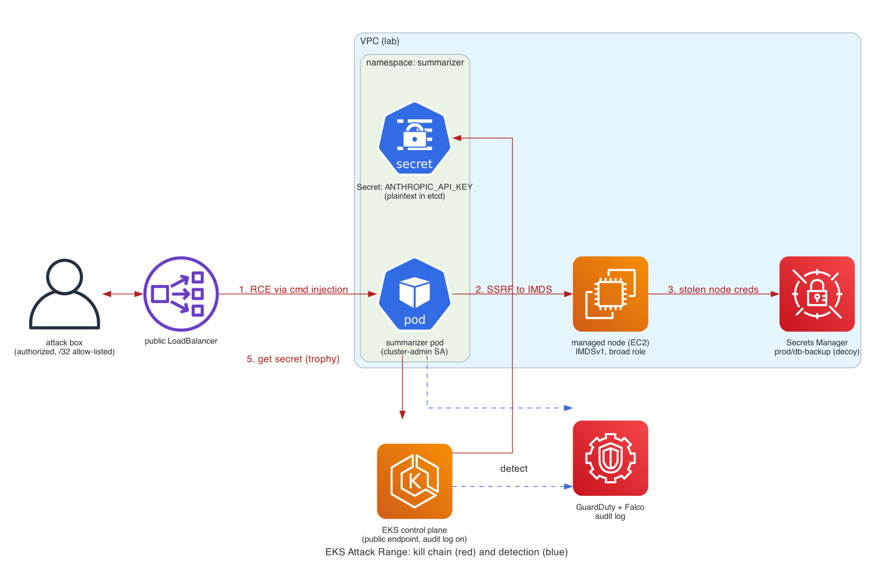

# EKS Attack Range

A deliberately-vulnerable EKS cluster, a scripted attack that chains five real
Kubernetes and AWS misconfigurations into a full compromise, and the blue-team
overlay that detects and reverses every step. It is the cloud translation of a
host-centric ethical-hacking course: the course runs recon, exploitation,
privilege escalation and automation against a local CTF virtual machine; this
runs the same lifecycle against managed Kubernetes, and ends by stealing an API
key out of a running pod.

Everything is authorized and self-contained: it runs in my own sandbox account,
the control-plane endpoint is locked to my own IP, the stolen "key" is a
throwaway revoked at the end, and the whole thing is deploy, demo, destroy.

## Problem

Most Kubernetes security advice is a list of settings with no attacker attached,
so it is hard to feel why any single one matters. The individually-small
defaults, IMDSv1 left on, a ServiceAccount token auto-mounted, a slightly-too-broad
node role, a secret in an environment variable, are each easy to wave away. The
point of this lab is to chain them: show that those five "minor" choices compose
into a path from one unauthenticated HTTP request to cluster-admin and a stolen
production credential, and then show that removing any one of them breaks the
chain.

## Architecture and kill chain



*An unauthenticated request hits the public LoadBalancer. Command injection in
the app gives RCE in the pod (1). From the pod, SSRF reaches the EC2 node's
instance metadata service and steals its IAM role credentials (2), which read
Secrets Manager account-wide (3). The pod's auto-mounted ServiceAccount token is
bound to cluster-admin, so it drives the API server directly (4) and reads the
plaintext Claude API key out of etcd (5). Control-plane audit logs, GuardDuty and
Falco see all of it (blue).*

## Decisions

- **The lab is the negative of a cluster I also run hardened.** Every weakness is
  an inversion of a control in my paved-road cluster, so each fix is a concrete
  one-line diff, not an abstract tip. See [ADR-0001](docs/adr/0001-invert-the-paved-road.md).
- **Safety is enforced in code, not just documented.** `variables.tf` refuses
  `0.0.0.0/0` on the control-plane endpoint, `make deploy` injects your own /32,
  the trophy key is created imperatively so it never lands in git, and the
  Secrets Manager decoy is an obviously fake value. See [ADR-0002](docs/adr/0002-throwaway-key-as-trophy.md).
- **Audit logging stays on in the vulnerable build.** The blue-team half depends
  on the attack being visible, so the misconfiguration is never "no logging."
- **The right way is in the repo too.** The hardened app path is the keyless
  Bedrock pattern from my golden-path copilot, so the fix for the stolen key is a
  real alternative, not just "use a secrets manager."

## The five weaknesses and their fixes

| # | Weakness (this lab) | Kill-chain use | Fix (paved road) |
|---|---------------------|----------------|------------------|
| 1 | Command injection in the app | RCE foothold | Input validation, no shell-out |
| 2 | IMDSv1 reachable, node hop limit 2 | Steal node role creds via SSRF | IMDSv2 required, hop limit 1 |
| 3 | Broad node IAM role | Read Secrets Manager account-wide | Minimal node role, scoped IRSA |
| 4 | cluster-admin SA + token automount | Drive the API as cluster-admin | Least-privilege RBAC, automount off |
| 5 | API key in a plaintext env Secret | The trophy | External Secrets, or keyless Bedrock |

## What broke while building it

- **A /32 does not clear the EKS public-access finding.** I expected scoping the
  endpoint to a single address to satisfy Trivy. It does not: `AVD-AWS-0041`
  fires on any public CIDR and only changes its message to name the /32. Only a
  private endpoint clears it, which is exactly why the paved road uses one. The
  `.trivyignore` documents this with the verification.
- **The IMDS hop limit is the whole exploit.** A pod is one network hop from the
  node, so the default hop limit of 1 already blocks pod-to-IMDS. The SSRF step
  only works because the node group sets hop limit 2. That one integer is both
  the vulnerability and, set back to 1, the fix.
- **Removing a base resource in kustomize needs an explicit delete patch.** The
  hardened overlay reuses the vulnerable manifests as its base, so dropping the
  cluster-admin binding meant a `$patch: delete` directive, not just leaving it
  out of the resource list.
- (Live-run findings, GuardDuty finding IDs and the audit-log screenshots, get
  appended here after a deploy.)

## Run it

Authorized use only, against infrastructure you own. Full steps in
[docs/runbook-aws.md](docs/runbook-aws.md).

```bash
export AWS_PROFILE=<sandbox>
export ANTHROPIC_API_KEY=sk-ant-...   # a THROWAWAY key, revoked at the end
make deploy      # VPC + vulnerable EKS + the app, endpoint scoped to your IP
make demo        # run the kill chain end to end
make harden      # apply the blue-team overlay, delete the trophy Secret
make test        # assert the controls now deny
make destroy     # tear everything down (verify nothing hourly survives)
```

## Repository layout

| Path | What it is |
|------|------------|
| `infra/` | The vulnerable EKS cluster (Terraform) |
| `app/` | The deliberately-vulnerable summarizer and its manifests |
| `attack/` | The scripted kill chain, mapped to MITRE ATT&CK for Containers |
| `defend/` | Detections (audit queries, Falco) and the hardening overlay |
| `docs/` | Runbook, ADRs, architecture diagram |

## Production scale

In a real estate this is the gap between a default cluster and a paved-road one.
At fleet scale the five fixes become platform defaults rather than per-cluster
work: IMDSv2 and a minimal node role in the node launch template every cluster
inherits, admission control (PodSecurity restricted plus a policy engine) that
rejects the privileged pod before it schedules, IRSA so no workload ever borrows
the node role, and secrets delivered by External Secrets from a secrets manager
so no key sits in etcd. The attack range is how you prove those defaults hold:
re-run the kill chain against any cluster and every stage should fail.
