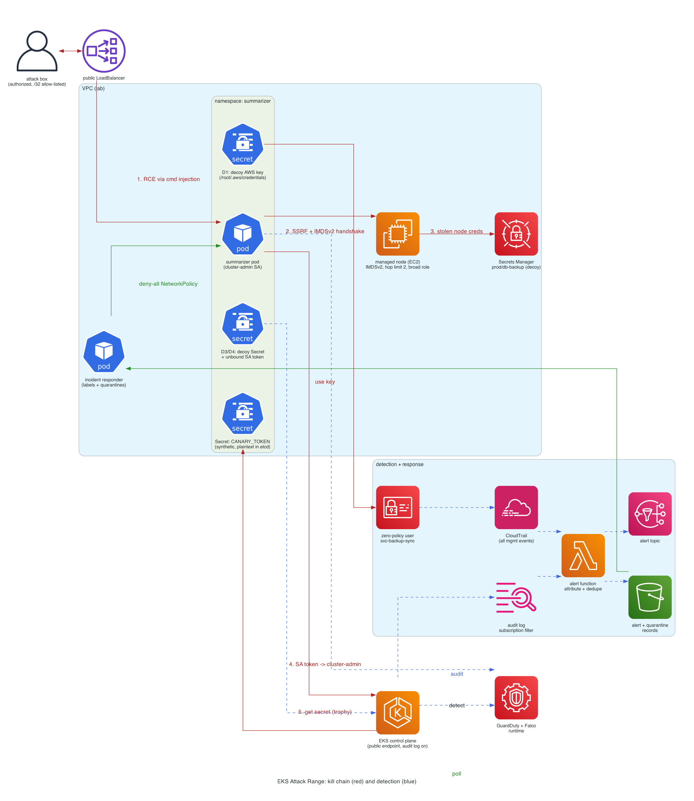

# EKS Attack Range

A deliberately-vulnerable EKS cluster, a scripted attack that chains five real
Kubernetes and AWS misconfigurations into a full compromise, and the blue-team
overlay that detects and reverses every step. It is the cloud translation of a
host-centric ethical-hacking course: the course runs recon, exploitation,
privilege escalation and automation against a local CTF virtual machine; this
runs the same lifecycle against managed Kubernetes, and ends by stealing a canary
credential out of a running pod.

Everything is authorized and self-contained: it runs in my own sandbox account,
the control-plane endpoint is locked to my own IP, the stolen "key" is a
synthetic canary with nothing to revoke, and the whole thing is deploy, demo, destroy.

## Problem

Most Kubernetes security advice is a list of settings with no attacker attached,
so it is hard to feel why any single one matters. The individually-small
defaults, IMDS reachable from pods, a ServiceAccount token auto-mounted, a slightly-too-broad
node role, a secret in an environment variable, are each easy to wave away. The
point of this lab is to chain them: show that those five "minor" choices compose
into a path from one unauthenticated HTTP request to cluster-admin and a stolen
production credential, and then show that removing any one of them breaks the
chain.

## Architecture and kill chain



*An unauthenticated request hits the public LoadBalancer. Command injection in
the app gives RCE in the pod (1). From the pod, SSRF reaches the EC2 node's
instance metadata service and steals its IAM role credentials (2), which read
Secrets Manager account-wide (3). The pod's auto-mounted ServiceAccount token is
bound to cluster-admin, so it drives the API server directly (4) and reads the
plaintext canary credential out of etcd (5). The control-plane audit log can show
the escalation when the stolen token is really used; GuardDuty and Falco are armed
for the runtime side (blue).*

## Decisions

- **The lab is the negative of a cluster I also run hardened.** Every weakness is
  an inversion of a control in my paved-road cluster, so each fix is a concrete
  one-line diff, not an abstract tip. See [ADR-0001](docs/adr/0001-invert-the-paved-road.md).
- **Safety is enforced in code, not just documented.** `variables.tf` refuses
  `0.0.0.0/0` on the control-plane endpoint, `make plan` injects your own /32,
  the trophy is a synthetic per-run canary token created imperatively so it
  never lands in git, accepted only by the in-cluster lab receiver, and the
  Secrets Manager decoy is an obviously fake value. See [ADR-0002](docs/adr/0002-throwaway-key-as-trophy.md).
- **Audit logging stays on in the vulnerable build.** The blue-team half depends
  on the attack being visible, so the misconfiguration is never "no logging."
- **The right way is in the repo too.** The hardened app path is the keyless
  Bedrock pattern from my golden-path copilot, so the fix for the stolen key is a
  real alternative, not just "use a secrets manager."

## The five weaknesses and their fixes

| # | Weakness (this lab) | Kill-chain use | Fix (paved road) |
|---|---------------------|----------------|------------------|
| 1 | Command injection in the app | RCE foothold | Input validation, no shell-out |
| 2 | IMDS reachable from pods (node hop limit 2) | Steal node role creds via SSRF + IMDSv2 handshake | hop limit 1, NetworkPolicy egress deny to IMDS |
| 3 | Broad node IAM role | Read Secrets Manager account-wide | Minimal node role, scoped IRSA |
| 4 | cluster-admin SA + token automount | Drive the API as cluster-admin | Least-privilege RBAC, automount off |
| 5 | API key in a plaintext env Secret | The trophy | External Secrets, or keyless Bedrock |

## What broke while building it

- **A /32 does not clear the EKS public-access finding.** I expected scoping the
  endpoint to a single address to satisfy Trivy. It does not: `AVD-AWS-0041`
  fires on any public CIDR and only changes its message to name the /32. Only a
  private endpoint clears it, which is exactly why the paved road uses one. The
  `.trivyignore` documents this with the verification.
- **The IMDS hop limit is the whole exploit.** A pod is one network hop from the
  node, so the default hop limit of 1 already blocks pod-to-IMDS. The SSRF step
  only works because the node group sets hop limit 2. That one integer is both
  the vulnerability and, set back to 1, the fix.
- **Removing a base resource in kustomize needs an explicit delete patch.** The
  hardened overlay reuses the vulnerable manifests as its base, so dropping the
  cluster-admin binding meant a `$patch: delete` directive, not just leaving it
  out of the resource list.
- **The account enforced IMDSv2 before I could ship the IMDSv1 weakness.** The
  first node group apply failed outright: `InvalidRequestException: You can't
  launch instances with IMDSv1 because httpTokensEnforced is enabled for this
  account.` That account-level guardrail is a good thing, so instead of weakening
  it, I made the lab honest: IMDSv2 is required, and the real weakness is the
  metadata hop limit of 2. The attack then does the IMDSv2 token handshake from
  inside the pod. The lesson is sharper for it: IMDSv2 does not save you if the
  hop limit lets a pod reach IMDS at all.
- **`kubectl --token=""` silently falls back to your kubeconfig admin.** When the
  hardened pod had no SA token to steal, the kill chain's `kubectl --token=$STOLEN`
  call ran as my admin context instead of failing, and returned "No resources
  found" rather than a clean denial. That is a misleading green. The honest proof
  of the fix is `kubectl auth can-i list secrets --as=system:serviceaccount:summarizer:summarizer`
  returning `no`, plus showing the token file is absent in the pod.
- **IPv4 matters for the endpoint allow-list.** `curl ifconfig.me` returned an
  IPv6 address on this network, and `<ipv6>/32` is not a valid CIDR, so the first
  apply failed on the EKS endpoint. `curl -4` fixes it. Small thing, lost a
  cluster-create to it.

## What the live run proved

Two live sessions on EKS 1.36. Session A (`evidence/aws-run1/`) landed the chain
but left two honest detection misses. Session B (`evidence/aws-run2/`) fixed the
cause of one miss and added the deception layer, so the same chain is now caught
and contained. Each session was one deploy, baseline demo, harden, hardened demo,
destroy, in an isolated account.

| Stage | Name | Baseline | Hardened | Detection | Control layer |
|---|---|---|---|---|---|
| 0 | Recon | info | info | - | discovery |
| 1 | Foothold via RCE | exploited | blocked | - | app (input validation) |
| 2 | SSRF to IMDS | exploited | blocked | - | app (fixed upstream) and cloud (IMDS hop limit) |
| 3 | Lateral move with node creds | exploited | error | - | cloud (scoped node IAM role) |
| 4 | Privilege escalation via SA token | exploited | blocked | audit log | Kubernetes (RBAC, automount off) |
| 5 | Trophy, read the canary Secret | exploited | blocked | audit log | Kubernetes (RBAC), no secret in env |
| 6 | Decoys, take and use planted credentials | exploited (detected) | error (unreachable) | CloudTrail + audit log | detection + pod quarantine |

- The baseline chain landed end to end. RCE as root, node role credentials
  stolen through the app's own SSRF by doing the IMDSv2 token handshake, the
  decoy `attack-range/prod/db-backup` secret read with those stolen
  credentials, and the cluster-admin token driving the API to the canary.
- `make verify-hardened` printed ALL CONTROLS HOLD for the five controls.
  Stage 3 reads `error` on the hardened run because it needs the credentials
  stage 2 no longer yields, which is the documented expectation and not a pass
  by itself.
- **Stages 4 and 5 now make real calls.** They read the pod's own mounted
  ServiceAccount token and call the API server, so the caller is the
  ServiceAccount and the escalation appears in the audit log as
  `system:serviceaccount:summarizer:summarizer` listing then getting
  `secrets/summarizer-key`, which the documented queries match. The old method,
  `kubectl auth can-i --as`, was a SubjectAccessReview under the operator that
  EKS never logs, which is why Session A's queries matched nothing
  (`evidence/aws-run1/detection.md`). The `--assume-breach` flag keeps that
  direct RBAC check for the hardened run.
- **GuardDuty stayed silent** in both sessions' windows, recorded as a miss, not
  smoothed over.

### Deception layer (Session B)

Three credentials are planted along the chain and nothing legitimate ever uses
them, so any use is an intruder. A single alert function catches each one, an
in-cluster responder quarantines the attributed pod with a deny-all
NetworkPolicy, and the demo records seconds to alert and to contained
([ADR-0005](docs/adr/0005-decoy-credentials.md), `evidence/aws-run2/`).

| Decoy | Planted | Caught by | Baseline result |
|---|---|---|---|
| D1 | AWS key in `/root/.aws/credentials` in the pod | CloudTrail via EventBridge | detected 2.1s, quarantined 3.9s |
| D3 | Secret `prod-db-backup-creds` | EKS audit log | detected 2.2s, quarantined 3.9s |
| D4 | unbound ServiceAccount `backup-operator` token | EKS audit log | detected 2.4s, quarantined 3.9s |

Each was attributed to the summarizer pod, D1 through a key-to-Secret map, D3 and
D4 through the audit event source IP, which is the pod's own IP because in-VPC
traffic to the API server is not source-NATed (verified as the first live check).

- **The decoy is a tripwire, not a shield, and the run says so.** In the
  realistic order the attacker already holds the node role, the ServiceAccount
  token and the trophy when the first alarm fires. A "held before alert" column
  records exactly that.
- **Even tested first, enforcement lags.** In the decoy-first order the planted
  key is used before the pivot. Detection is 2.2s and the quarantine label lands
  at 3.4s, but the VPC CNI dataplane takes a few more seconds to deny traffic, so
  the SSRF still reaches IMDS and the deeper pivot is cut off mid-step. The label
  time is not the enforcement time.
- The node-level response, revoking the already-stolen node session, is out of
  scope here and proven in `aws-incident-forensics` (ADR-0005).
- Teardown removed every resource, deleted the minted decoy key first, and
  `make verify-gone` plus an out-of-band sweep reported the cluster, the decoy
  user and key, the alert bucket, rule and function all gone.

An AKS port is designed but has not run
([ADR-0004](docs/adr/0004-aks-port.md)). IMDS has no hop limit on AKS, so the
control becomes an egress policy, the node identity is a managed identity,
and Defender for Containers is recorded beside Falco, because the
self-healing lab's own AKS run saw it raise no alert naming the attacked pod.

## Run it

Authorized use only, against infrastructure you own. Full steps in
[docs/runbook-aws.md](docs/runbook-aws.md).

```bash
export AWS_PROFILE=<sandbox>
make plan            # saved plan, endpoint scoped to your IP; read it, apply infra/tfplan
make deploy          # after the apply: images + app + receiver
make decoys          # plant D1/D3/D4, deploy the responder, mint the D1 key out of state, verify
make demo            # judge every stage on the baseline; stage 6 = decoys detected + quarantined
make harden          # hardened image + overlay, delete the trophy Secret, then verify
make verify-hardened # prove all five controls hold (run again or part of harden)
make destroy-plan    # delete the decoy key, remove the app, write destroy.tfplan; apply, then make verify-gone
```

No vendor API key is needed. The trophy is a synthetic canary token minted per
run and accepted only by the in-cluster lab receiver, so there is nothing real
to revoke. `make test` runs the Python unit tests; `make check` adds the Terraform
and manifest gates.

## Repository layout

| Path | What it is |
|------|------------|
| `infra/` | The vulnerable EKS cluster (Terraform) |
| `app/` | The deliberately-vulnerable summarizer and its manifests |
| `attack/` | The scripted kill chain, mapped to MITRE ATT&CK for Containers |
| `defend/` | Detections (audit queries, Falco) and the hardening overlay |
| `docs/` | Runbook, ADRs, architecture diagram |

## Production scale

In a real estate this is the gap between a default cluster and a paved-road one.
At fleet scale the five fixes become platform defaults rather than per-cluster
work: IMDSv2 and a minimal node role in the node launch template every cluster
inherits, admission control (PodSecurity restricted plus a policy engine) that
rejects the privileged pod before it schedules, IRSA so no workload ever borrows
the node role, and secrets delivered by External Secrets from a secrets manager
so no key sits in etcd. The attack range is how you prove those defaults hold:
re-run the kill chain against any cluster and every stage should fail.
